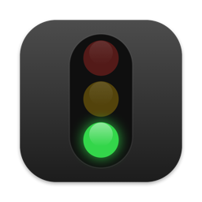
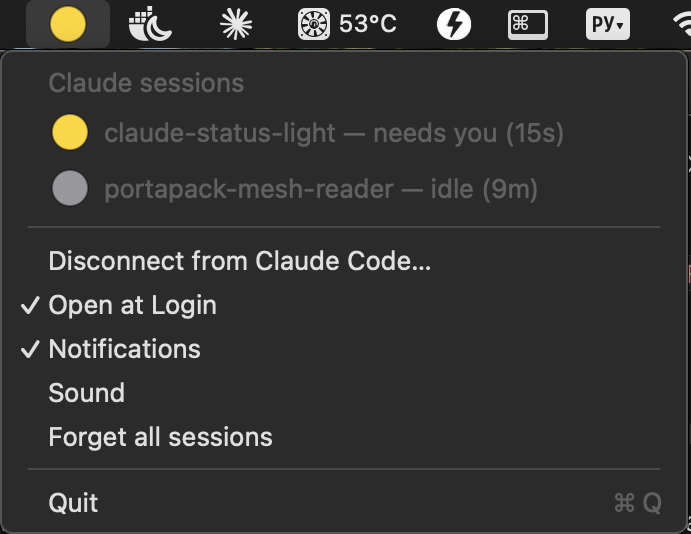

 

# ClaudeStatus

A traffic light for [Claude Code](https://code.claude.com) in the macOS menu bar. One dot shows how all your Claude Code sessions are doing:

| Dot | Meaning |
|---|---|
| grey | idle: nothing running, or Claude finished and has nothing to ask |
| green | working |
| yellow, blinking | Claude is waiting for you: a permission prompt, a question dialog, a plan to approve, or a reply that ends with a question |
| red, blinking | the turn failed (API error, rate limit…) |

With several sessions the worst one wins. Click the dot to see every session, its project folder and how long it has been in that state.



Works with everything that runs Claude Code hooks: the `claude` CLI, the **Code** tab of the Claude desktop app, and the VS Code / JetBrains extensions. Plain chats on claude.ai don't run hooks and aren't shown.

*Unofficial: not made or endorsed by Anthropic. Built with the help of an AI assistant (Claude).*

[Українська версія нижче](#українською)

## Install

**Requires macOS 13 or newer.**

### Option A: download

1. Download `ClaudeStatus.zip` from Releases, unzip it, move `ClaudeStatus.app` to `/Applications` (or `~/Applications`).
2. The app is not notarized by Apple, so the first launch is blocked. Either right-click the app → **Open** → **Open**, or (macOS 15+) try to open it once, then go to **System Settings → Privacy & Security** and click **Open Anyway**. Or in Terminal:
   ```bash
   xattr -d com.apple.quarantine /Applications/ClaudeStatus.app
   ```

### Option B: build from source (no Gatekeeper warning)

Needs Xcode Command Line Tools (`xcode-select --install`).

```bash
git clone <this repo> && cd claude-status-light && app/build.sh
```

The app lands in `build/ClaudeStatus.app`.

### Connect to Claude Code

On first launch the app offers to connect; later it's in the menu: **Connect to Claude Code…**. It shows exactly what it adds to `~/.claude/settings.json`, saves a backup next to it (`settings.json.bak-claudestatus-…`) and keeps your other settings and hooks. **Disconnect from Claude Code…** removes only its own hooks. Running sessions pick the change up on their next event.

Turn on **Open at Login** in the menu to start it automatically.

## Privacy and footprint

- The hook script (`report.sh`, plain bash, no python/jq) writes one line per session to `~/.claude-status/<session id>`: state, project folder name, event name. Your prompts and Claude's replies are not stored; the end of the last reply is only checked for a question mark and then discarded.
- No network access, no telemetry, no analytics.
- No polling: the app sleeps until a status file changes (FSEvents). The blink timer exists only while the dot is yellow or red. About 0.1% CPU and ~20 MB of memory.
- Hooks run with `"async": true`, so Claude never waits for them.

## Uninstall

Menu → **Disconnect from Claude Code…**, turn off **Open at Login**, quit, then delete the app, `~/.claude-status` and `~/Library/Application Support/ClaudeStatus`.

## License

MIT, see [LICENSE](LICENSE).

---

## Українською

Світлофор для [Claude Code](https://code.claude.com) у рядку меню macOS. Одна крапка показує стан усіх сесій Claude Code:

| Крапка | Значення |
|---|---|
| сіра | нічого не відбувається або Claude закінчив і ні про що не питає |
| зелена | Claude працює |
| жовта, блимає | Claude чекає на вас: дозвіл, питання з варіантами, план на схвалення або відповідь із питанням наприкінці |
| червона, блимає | хід завершився помилкою (помилка API, ліміт…) |

Якщо сесій кілька, показується найтривожніша. Після кліку видно всі сесії, теку проєкту і скільки часу сесія в цьому стані.


Працює з усім, що запускає хуки Claude Code: CLI `claude`, вкладка **Code** у застосунку Claude для комп’ютера, розширення для VS Code і JetBrains. Звичайні чати на claude.ai хуків не запускають і не відображаються.

*Неофіційний застосунок, Anthropic до нього не має стосунку. Зроблено за допомогою ШІ-асистента (Claude).*

### Встановлення

Потрібна macOS 13 або новіша.

**Завантажити.** Завантажте `ClaudeStatus.zip` з Releases, розпакуйте, перенесіть `ClaudeStatus.app` у «Програми». Застосунок не нотаризований Apple, тому перший запуск заблоковано: правий клік на застосунку → **Відкрити** → **Відкрити**, або (macOS 15+) спробуйте відкрити, потім **Системні параметри → Приватність і безпека → Усе одно відкрити**. Або в Терміналі:

```bash
xattr -d com.apple.quarantine /Applications/ClaudeStatus.app
```

**Зібрати з вихідного коду** (без попередження): потрібні Command Line Tools (`xcode-select --install`), потім `app/build.sh`, застосунок з’явиться в `build/ClaudeStatus.app`.

**Підключення.** Під час першого запуску застосунок сам запропонує підключитися, далі це пункт меню **Connect to Claude Code…**. Він покаже, що саме додасть у `~/.claude/settings.json`, збереже поруч резервну копію і не зачепить ваші інші налаштування та хуки. **Disconnect from Claude Code…** прибирає лише свої хуки. Пункт **Open at Login** вмикає автозапуск.

### Приватність

Хук записує лише стан, назву теки проєкту та назву події в `~/.claude-status`. Тексти запитів і відповідей не зберігаються: кінець останньої відповіді лише перевіряється на знак питання. Жодної мережі й телеметрії. Без опитування: застосунок спить, доки не зміниться файл стану; близько 0.1% CPU і ~20 МБ пам’яті.

### Видалення

Меню → **Disconnect from Claude Code…**, вимкнути **Open at Login**, вийти, видалити застосунок, `~/.claude-status` і `~/Library/Application Support/ClaudeStatus`.
